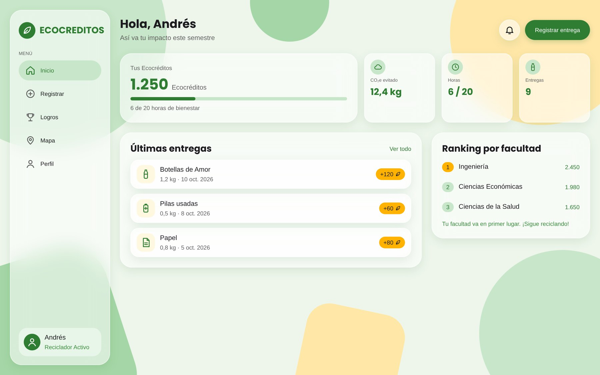
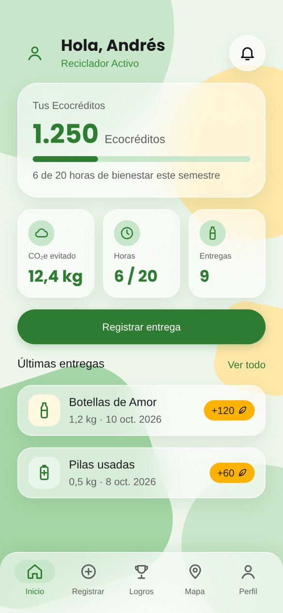
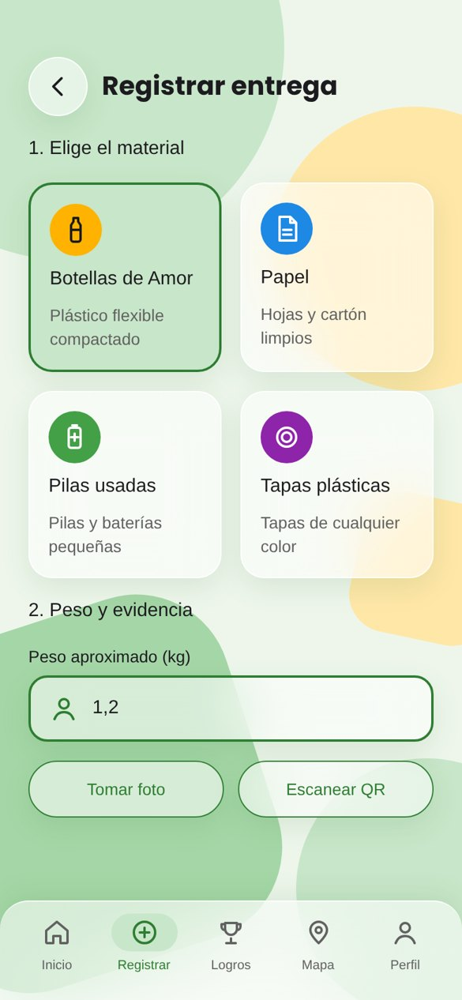
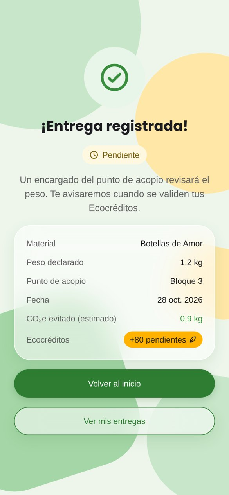
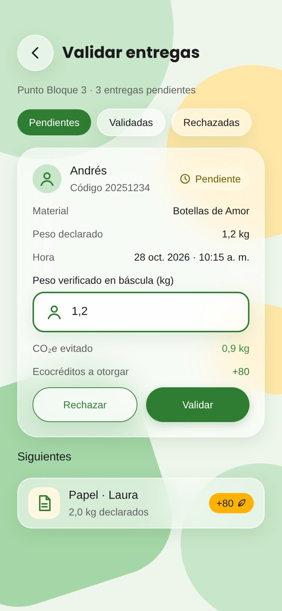
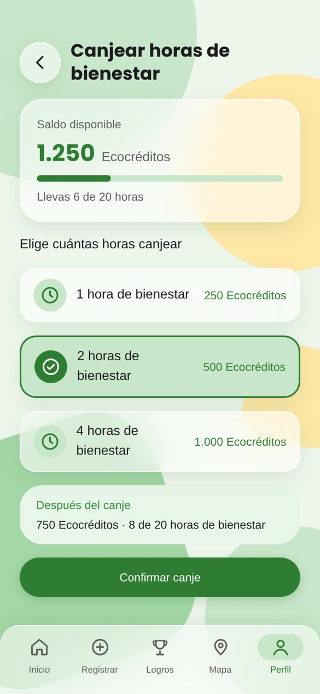

# ECOCREDITOS · Caso de estudio UX/UI

ECOCREDITOS: es una plataforma para que los estudiantes de la Universidad Cooperativa de Colombia (sede Medellín) registren sus entregas de reciclaje, las validen en el punto de acopio y las canjeen por horas de bienestar universitario.

 Caso de estudio en web: `https://TU-USUARIO.github.io/ecocreditos-ux-ui/`
 Prototipo en Figma: https://www.figma.com/design/3Xo7Q1w754EbxUVsKa5a7X

 Tipo: Proyecto académico, Ingeniería de Software, UCC Medellín (2026) |
 Equipo:  3 estudiantes 
 Mi rol: Investigación con usuarios, requerimientos e historias de usuario, Kanban en Trello, y diseño de la interfaz en Figma (UI kit, pantallas y prototipo) |
 Herramientas: Figma, FigJam, Trello |
 Alcance:Prototipo navegable para celular y PC (sin desarrollo de backend) |

## El problema

La universidad tenía campañas ambientales (Botellas de Amor, papel, pilas y tapas plásticas), pero ningún sistema registraba ni verificaba la participación. Los estudiantes no veían reconocido su esfuerzo y cumplir las horas de bienestar se sentía como un trámite.

## Proceso (Design Thinking)

1. Investigación: investigación de desktop, mapa de competencia (RECICLOS, Recypuntos, Lealtad Verde), encuesta de 7 preguntas (muestra de 357 de 4.891 participantes de Bienestar) y entrevistas individuales.
2. Definición: user persona, punto de vista (POV), brief e hipótesis medible.
3. Ideación: preguntas "¿Cómo podríamos…?", FODA y matrices de viabilidad.
4. Prototipado: design system y 20 pantallas en Figma.
5. **Evaluación: pruebas de usabilidad (siguiente etapa).

> POV: Un estudiante de la UCC comprometido con el medio ambiente necesita registrar y validar rápido sus entregas y ver reconocido su aporte, porque hoy sus acciones no quedan registradas y las horas de bienestar se sienten como un trámite.

## Design system

- Estilo: fondo flat con formas sólidas y tarjetas de glassmorfismo, sobre una base Material Design 3.
- Tipografía: Poppins para títulos y cifras; Roboto para textos y datos.
- Color: verde bosque `#2E7D32`, verde menta `#C8E6C9`, ámbar `#FFB300`, carbón `#1C1B1F`, verde niebla `#EEF6EC`, más colores de estado (error, advertencia, éxito, información).
- Componentes en Figma: botones (3 tipos × 5 estados), campos con estado de error, búsqueda y filtros, etiquetas de estado, tarjetas, medallas, navegación inferior (celular) y menú lateral (PC), y 24 íconos propios.
- Variables: para tema claro y oscuro.

 Botones  Íconos 

 [Botones](docs/img/k-buttons.jpg) | [Íconos](docs/img/k-icons.jpg) |

## Pantallas

| Inicio | Registrar | Entrega registrada | Validación | Canje |

|  |  |  |  |  |

Flujo principal: inicia sesión → registra la entrega (foto o QR) → queda pendiente → el encargado valida el peso → suma Ecocréditos → canjea horas de bienestar.

## Lo que aprendí

- Las decisiones de diseño salieron de la investigación: registrar con QR o foto, mostrar el saldo y las horas al iniciar sesión, y canjear por horas de bienestar.
- Construir variables, estilos y componentes antes de las pantallas permitió sacar la versión de PC y el modo oscuro sin rediseñar desde cero.

Proyecto académico desarrollado en equipo por J. Guevara, S. Vargas y E. A. Carrillo · Universidad Cooperativa de Colombia, sede Medellín.
